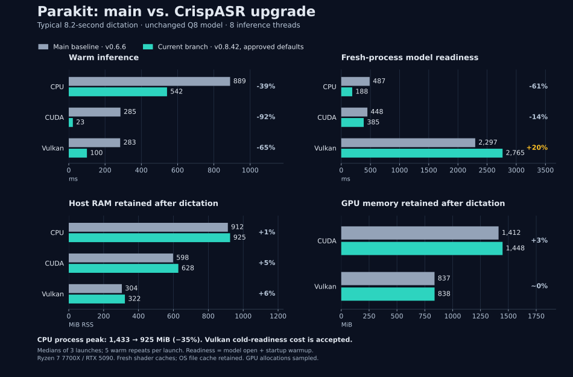

# CrispASR v0.8.42 upgrade

Parakit pins [CrispASR v0.8.42](https://github.com/CrispStrobe/CrispASR/releases/tag/v0.8.42) at `3be8bcb4390b8080dc73f807b7abb34dc0aca9c3`. Ordinary transcription remains the shipping path. The reviewed lower-memory controls are now startup defaults; explicit environment overrides are preserved. Official NVIDIA/NeMo comparison and contextual listening review are complete. Linux acceptance is complete for the tested ordinary-transcription path, with the reviewed memory exception and Vulkan cold-start trade-off accepted.

## Summary

The chart compares an isolated pre-upgrade main build (v0.6.6) with the upgrade's ordinary v0.8.42 transcription and approved lower-memory defaults. It uses a typical 8.2-second dictation, the unchanged Q8 model and the same `--threads 8` request. The old native CPU backend defaults to four threads; v0.8.42 applies the requested eight, as explained under [method](#inputs-and-method). Readiness means model open plus startup warmup; inference timings exclude cleanup and insertion.

- **Everyday speed:** Warm inference for this clip falls by 39% on CPU, 92% on CUDA and 65% on Vulkan. First and warm inference pass the agreed latency gate across the measured 2-31-second clips.
- **Memory:** Retained host RSS after this clip rises by approximately 13/30/18 MiB on CPU/CUDA/Vulkan; retained GPU allocation rises by 36 MiB on CUDA and less than 1 MiB on Vulkan. CPU process peak falls from 1,433 to 925 MiB, a 35% reduction.
- **Accepted trade-offs:** Fresh-process Vulkan readiness is about 20% slower. The separate 125-second CUDA test retains about 143 MiB more host memory after standalone model offload, versus 92 MiB more in the real worker. Both exceptions were reviewed and accepted; their detailed measurements remain below.
- **Long audio and quality:** Official NeMo output matches ordinary transcription on the full 55-second and repeated 265-second inputs apart from case/punctuation. Direct listening identifies a very quiet aside in the 125-second recording that both old CrispASR and full-input NeMo omit; the candidate partially recovers it, with word errors. The clear task sentence survives in every implementation. Listening also confirms the candidate's `forever` in the 31-second case, despite an audible disturbance within the word. Bounded mode remains unshipped because of wording changes and boundary latency regressions; native macOS/Windows testing remains for the laptops.

## Why this release and what changes at runtime

The upgrade brings Parakit's native runtime, ggml and Rust bindings to one tagged release. The reasons extend beyond memory measurements:

- **Session behavior:** Ordinary non-Japanese Parakeet transcription now uses the shared orchestrator, including memory-aware strategy selection and post-decode gap repair. This changes recognition behavior even though Parakit keeps calling ordinary `transcribe`. In the 125-second comparison, repair partially recovers a very quiet spoken aside omitted by the baseline; its wording remains imperfect. See the [pinned session dispatch](https://github.com/CrispStrobe/CrispASR/blob/v0.8.42/src/crispasr_c_api.cpp#L6201-L6252).
- **CUDA execution:** The newer encoder selects manual attention on CUDA and replaces the strided sigmoid construction with fused sigmoid GLU, addressing two old operation shapes that forced CPU fallback. These are concrete execution improvements; the timing comparison does not isolate their individual contributions. See the [attention policy](https://github.com/CrispStrobe/CrispASR/blob/v0.8.42/src/core/fastconformer.h#L66-L87) and [fused GLU](https://github.com/CrispStrobe/CrispASR/blob/v0.8.42/src/core/fastconformer.h#L956-L964).
- **Allocation handling:** The encoder checks its estimated allocation against available physical memory before constructing an unsafe full-attention graph. This is separate from strategy selection and does not establish recovery from every GPU allocation failure. See the [allocation guard](https://github.com/CrispStrobe/CrispASR/blob/v0.8.42/src/parakeet.cpp#L1008-L1030).
- **Model loading:** The newer loader uses mmap by default, changing loading and host residency accounting. Repeated offload/reload was therefore tested explicitly. This report does not attribute a mapping leak to the old pin. See the [loader default](https://github.com/CrispStrobe/CrispASR/blob/v0.8.42/src/core/gguf_loader.cpp#L499-L504).
- **Backend compatibility:** The ggml update includes the restored Metal matrix-multiplication kernel needed to avoid an abort on affected Apple GPUs. This is an upstream fix to validate on the laptop, not a locally demonstrated Mac result. See the [v0.8.42 release](https://github.com/CrispStrobe/CrispASR/releases/tag/v0.8.42).
- **Model correctness:** Parakeet preprocessing now removes the extra STFT boundary frame to match NeMo's valid mel-frame count; this change applies to the current input path. Upstream also corrected batch-normalization folding for F32 encoder weights and the default for missing v3 encoder-scaling metadata. These fixes improve fidelity to the reference implementation, with applicability depending on the model: the unchanged daily Q8 model already explicitly disables encoder scaling. The quiet-aside recovery below is specifically attributable to gap repair, rather than evidence for an individual encoder fix. See the [mel-frame correction](https://github.com/CrispStrobe/CrispASR/commit/370a2358ea9c54e993d919b044212fc8861183f9), [F32 folding correction](https://github.com/CrispStrobe/CrispASR/commit/73519479854a12f53032b87de435ce07e6fdb7a9) and [scaling fallback](https://github.com/CrispStrobe/CrispASR/blob/v0.8.42/src/parakeet.cpp#L373-L386).

Parakit's integration changes below also remove competing native compilation and replace its private ggml layout assumptions. Those changes make the chosen runtime and device-query ABI consistent across the native and Rust components.

### Long-audio behavior shipped

Ordinary transcription retains a default single-pass duration cap of 300 seconds, subject to the orchestrator's memory policy. The dependency update therefore brings its orchestration and gap repair without forcing every dictation into 30-second windows. See the [strategy resolver](https://github.com/CrispStrobe/CrispASR/blob/v0.8.42/src/parakeet_orchestrate.cpp#L525-L594).

Gap repair checks the word timeline for uncovered spans at the beginning, middle and end of the input. With upstream defaults it retries gaps of at least three seconds in windows no longer than approximately 30 seconds, with 0.2 seconds of surrounding context and at most two repair rounds. This is directly relevant to occasional missing sentences in longer dictations. It is a mitigation, not evidence that every previously reported omission is fixed: smaller gaps, inaccurate timestamps and speech absent from the captured PCM remain outside that guarantee. Nonempty text without word timings bypasses repair. See the [gap detection](https://github.com/CrispStrobe/CrispASR/blob/v0.8.42/src/parakeet_orchestrate.h#L198-L237) and [repair implementation](https://github.com/CrispStrobe/CrispASR/blob/v0.8.42/src/parakeet_orchestrate.cpp#L242-L355).

The separate bounded-default experiment requests approximately 30-second windows through `transcribe_chunked(pcm, 0, -1)`. It was evaluated on 29/31-second boundaries and the 55/125/265-second corpus on CPU, CUDA and Vulkan. It remains unshipped because of the recognition changes and 31-second latency regressions documented below. The supplied usage durations determined test priority; long-audio evaluation was also completed.

## Integration changes

Parakit owns native compilation through concrete Cargo `links` overrides for Linux GNU x86_64/aarch64, Apple arm64, and Windows x86_64 MSVC/GNU. Its parent build script retains external-library discovery, backend/BLAS selection, C++ runtime linkage, RPATHs, quantizer installation and Windows staging. Run Cargo from the repository root so its configuration is loaded. See [build instructions](../build.md) for the source and library overrides.

The exact nested pins are ggml `c36dab89b662838f0f5d4826c399198c0b90bbfc` and c2pa-audio `e40329b83f16f67bb5ddc7bb13ae18de0a9376fc`. The two Rust path crates and lockfile move with the native sources. The session adapter retains ABI version 2, checked sample counts, explicit CPU/GPU selection and RAII cleanup. It copies only segment text, avoiding word, timing, confidence and no-speech metadata that Parakit's text-only transcription API does not use. Automatic device selection continues through the upstream Rust wrapper; both paths share the same text joining behavior.

A small C++ adapter replaces Rust's private ggml layout mirrors. It compiles against the selected native headers and preserves PCI matching, conservative Windows NVIDIA free-memory readings and Metal wrapped-value handling. Optional Opus/AMR decoders are disabled for Parakit's PCM input. Mel BLAS follows Parakit's BLAS selection. Parakit disables the extra pointwise-Q8 and fused-QKV weight copies by default with `CRISPASR_FC_PW_Q8=0` and `CRISPASR_FC_FUSED_QKV=0`. Other upstream compute defaults are retained.

The daemon and `transcribe-file` initialize these defaults before starting threads or opening a model. Library users can supply the variables when launching their process or call the unsafe startup initializer before threads and native initialization. `Engine::open` does not mutate these variables from an inference worker. No CLI flag or configuration key is added.

Worker ownership, startup/reload warmup shapes, idle offload and the 1 GiB reload allowance are unchanged. Parakit receives one patch increment from 0.4.1 to 0.4.2. Installation guidance now uses the validated lockfile, names the optional accelerator features and explains the installed binary's native-library dependency. CI is unchanged.

## Inputs and method

Ignored `target/tmp/crispasr-upgrade/` holds source snapshots, separate release builds and matching libraries, frozen audio, runners, logs and raw measurements. The compared states are original v0.6.6, v0.6.6 with one native builder, ordinary v0.8.42, and an isolated bounded-default v0.8.42 experiment. The bounded snapshot changes both entry points to `transcribe_chunked(pcm, 0, -1)` and uses the ordinary candidate's matching native library. It adds no public setting.

The unchanged copied installed Q8 model is 745,121,632 bytes and contains `parakeet.xscaling = false`. No fixture hashes, conversion or requantization were introduced. The missing-metadata upstream scaling fix therefore does not establish a quality improvement for this model. The new runtime can still transform weights in memory, as described below.

The supplied usage EDA reports a median capture of 8.24 seconds, P75 of 16.56 seconds and P90 of 29.28 seconds. Captures of at least 30 seconds are 9.5% of entries. Everyday 2/5/8.2/15/25-second cases take priority, with 29/31-second boundaries, subsecond speech and silence also included. Long coverage inputs are two real recordings of 55.36 and 125.48 seconds, plus a clearly labeled 265-second repeated-audio stress input. The latter is not an independent natural dictation.

The supplied 55-second expected text remains frozen historical validation text. Its original provenance is unestablished, but the independent official NVIDIA/NeMo run below now corroborates its words apart from case/punctuation. Old Parakit/CrispASR outputs remain comparison baselines only: agreement alone does not establish correct recognition. The official model reference comes from NVIDIA's original Parakeet-TDT-0.6B-v3 through NeMo on the same WAV inputs. Human listening evidence is labeled separately, including the user's review of the disputed 125-second excerpt. Raw text is compared before cleanup. Nonempty output alone does not establish recognition quality; capitalization and punctuation alone do not fail quality.

Measurements use the same `--threads 8` request with fixed OpenMP/OpenBLAS/MKL thread settings, the same compiler, release profile and warmup policy. Source inspection confirms that v0.6.6 stores the requested count without applying it to its ggml CPU backends, which initialize with a four-thread default. v0.8.42 applies the request to both the selected CPU backend and CPU fallback. The results therefore compare actual old/new behavior at the same user setting, including this upstream fix; they are not comparisons with an identical effective ggml CPU thread count. The CPU gains cannot be attributed solely to other kernel changes. See the [old initialization](https://github.com/CrispStrobe/CrispASR/blob/v0.6.6/src/parakeet.cpp#L1201-L1219), [old backend default](https://github.com/CrispStrobe/CrispASR/blob/v0.6.6/ggml/src/ggml-cpu/ggml-cpu.cpp#L217-L226) and [new initialization](https://github.com/CrispStrobe/CrispASR/blob/v0.8.42/src/parakeet.cpp#L3115-L3130).

Each short clip has three fresh launches and five measured warm repetitions after first inference. Long clips have three fresh launches and one inference per launch. Reported warm medians weight independent launches equally. Open, startup warmup, first inference, warm inference and production reload are separate.

The Linux host has a Ryzen 7 7700X and an RTX 5090. All compared builds use Rust 1.98, release optimization, OpenBLAS, native CPU code, OpenMP and CPU repacking. CPU-only, CUDA-only and Vulkan-only builds resolve their own matching libraries. CUDA uses toolkit 12.9 and native architecture selection. The old runtime defaults `GGML_LLAMAFILE` off; v0.8.42 defaults it on. That upstream change is retained. Candidate mel BLAS is on with the selected OpenBLAS policy; Opus/AMR and dynamic backend plugins are off.

Initial clean original builds show both sys and parent native compilation; their binaries resolve the parent libraries. Clean ownership/candidate builds show one parent native compilation and no sys CMake fallback. Subsequent original probe rebuilds run from the repository root with its new Cargo override; the initial verbose build logs preserve the unchanged-build evidence.

Each test has isolated configuration, cache, runtime and GPU shader-cache directories. The OS file cache is not flushed; "cold" below refers to a fresh process and shader cache, not uncached storage. The installed daemon stays running. Read-only status monitoring stops the test child on recording, inference, loading, count changes or lost monitoring. Builds are paused or finished during timing windows; functional smokes performed during compilation are excluded from performance results.

Host RSS high-water values come from fresh processes. RSS, anonymous/file residency and PSS are recorded separately. GPU values are sampled per-process allocations, not exact allocator peaks. A reproducible latency increase over 10% blocks acceptance. Comparable memory increases must exceed both 10% and 128 MiB to fail; unresolved accounting is not a pass.

Checkpoint analysis selects interior samples from the raw stage groups rather than their last sample, which can cross a destruction boundary. Missing or unstable windows remain visible. Component residency changes explain mmap behavior; memory gates use comparable total RSS/PSS, host HWM and GPU allocation. Sampling can miss short GPU peaks, especially the fastest CUDA inferences. For zero-repeat long runs, the two adjacent post-inference holds contain no intervening inference or engine teardown. Analysis validates that event order, combines them into one retained-memory interval, requires three samples, discards its first and last samples and takes the interior median. This resolves the sparse constituent windows without counting them as independent checkpoints.

## Official NVIDIA/NeMo comparison

On 2026-10-11, NVIDIA's original [Parakeet-TDT-0.6B-v3 checkpoint](https://huggingface.co/nvidia/parakeet-tdt-0.6b-v3) at repository revision `541d1f99c6b0c3cd0b11a95167540bb8edefd82b` was restored directly through NeMo's `ASRModel.restore_from`. The run used NeMo 3.0.0, PyTorch 2.14.0 with CUDA 13.0, and an RTX 5090. The unquantized model ran in F32 with TF32 matrix multiplication disabled, full-context relative-position attention and its unchanged `greedy_batch` TDT decoder. No conversion, quantization or decoder tuning was applied. This is a recognition reference, not a speed or memory comparison with the Q8 native builds.

The reference transcribed all seven 2-31-second speech clips, both full natural recordings, the repeated 265-second stress input, one second of silence and the 11-second contextual quiet-aside excerpt. Standalone subsecond speech was excluded. All 12 per-inference main-daemon activity guards were clean; the installed instance remained running. The run waited for idle before each inference and stopped on conflicting activity. Raw outputs and actual runtime settings remain ignored in `target/tmp/crispasr-upgrade/nemo-official/launch-3/`.

Comparison covered every distinct raw transcript from the clean native launches and repetitions on CPU, CUDA and Vulkan. The table describes word differences after ignoring case/punctuation; it is not WER against a human transcript. NeMo output is the official model reference, while listening establishes what was actually spoken when implementations disagree.

| Input | Official reference and ordinary candidate | Interpretation |
|---|---|---|
| 2 seconds | Both return `Um so`; old CrispASR returns `Um`. | Candidate recovers the reference's `so`. |
| 5 / 8.2 / 15 seconds | Old and candidate match NeMo apart from case/punctuation. | No differing words. |
| 25 seconds | NeMo writes `me'cause`; both native versions write `me because`. | Contraction/spacing difference with the same meaning. |
| 29 seconds | NeMo and candidate use `gonna`; old CPU/CUDA use `going to`, while old Vulkan matches. | Equivalent wording. |
| 31 seconds | NeMo and old CrispASR end with `for over`; candidate ends with `forever`. | Human contextual listening confirms `this person just pacing around forever`, with an audible disturbance within `forever`. Candidate wording agrees with the spoken phrase. |
| Full 55 seconds | Both native versions match NeMo apart from case/punctuation. | Independently corroborates the historical expected words. |
| Full 125 seconds | Old CrispASR matches NeMo; candidate adds `think that else. Uh`. | Human listening confirms real quiet speech; the candidate's partial recovery has word errors. See below. |
| Repeated 265 seconds | Both native versions match NeMo apart from case/punctuation. | No new word omissions or repetitions relative to the official output on this synthetic stress input. |
| 1-second silence | NeMo and both native versions return empty text. | Silence behavior agrees. |
| 11-second quiet-aside excerpt | NeMo returns `Um think of it else. Uh I need to do things also`. | NeMo also recovers part of the aside with local context, despite omitting it on the full recording. Human listening remains the wording evidence. |

The user reviewed the 10-second contextual excerpt spanning source seconds 23-33 on 2026-10-11 and confirmed `this person just pacing around forever`, followed by fillers and further speech. The user also reported an audible disturbance specifically within `forever`, absent from the surrounding words. This resolves the candidate's disputed wording in favor of the spoken phrase; the disturbance's cause was not diagnosed. The listening excerpt includes two seconds beyond the tested cut and remains ignored at `target/tmp/crispasr-upgrade/audio-review/boundary-context-23-33s.wav`. Official same-input NeMo output remains recorded separately; its `for over` is a model-reference discrepancy, not the human-confirmed wording.

## Initial 8.2-second results

These are three-launch pilot results, not full-corpus acceptance. All raw transcripts agree across the four states on this clip.

| CPU state | First inference | Warm inference | Host HWM | Post-inference RSS |
|---|---:|---:|---:|---:|
| Original v0.6.6 | 911 ms | 888 ms | 1,433 MiB | 912 MiB |
| One-builder v0.6.6 | 929 ms | 903 ms | 1,433 MiB | 912 MiB |
| v0.8.42 ordinary | 613 ms | 530 ms | 1,082 MiB | 1,082 MiB |
| v0.8.42 bounded | 634 ms | 539 ms | 1,082 MiB | 1,082 MiB |

The ordinary CPU candidate is faster and has a lower peak, but retained PSS increases from 907 to 1,077 MiB. This crosses the agreed memory gate. File-backed PSS increases while anonymous PSS decreases; the total increase is corroborated by RSS and is not waived as an mmap accounting difference.

| Vulkan state | First inference | Warm inference | Open + startup warmup | Post-inference GPU allocation |
|---|---:|---:|---:|---:|
| Original v0.6.6 | 1,073 ms | 289 ms | 2,403 ms | 837 MiB |
| One-builder v0.6.6 | 1,042 ms | 285 ms | 2,342 ms | 837 MiB |
| v0.8.42 ordinary | 512 ms | 108 ms | 3,000 ms | 991 MiB |
| v0.8.42 bounded | 501 ms | 97 ms | 3,017 ms | 991 MiB |

Vulkan inference improves, but upstream defaults exceed the memory gate by 153 MiB of GPU allocations and the readiness latency gate by about 25%. Host HWM is approximately unchanged. These results use isolated fresh shader caches; they do not establish performance with a previously populated cache.

| CUDA state | First inference | Warm inference | Open + startup warmup | Post-inference GPU allocation |
|---|---:|---:|---:|---:|
| Original v0.6.6 | 287 ms | 284 ms | 449 ms | 1,412 MiB |
| One-builder v0.6.6 | 292 ms | 284 ms | 440 ms | 1,412 MiB |
| v0.8.42 ordinary | 19 ms | 19 ms | 655 ms | 1,604 MiB |
| v0.8.42 bounded | 18 ms | 16 ms | 644 ms | 1,604 MiB |

CUDA defaults also fail retained memory and readiness gates, despite faster inference. Host HWM changes from approximately 981 to 989 MiB. The 192 MiB GPU allocation increase includes allocator behavior beyond the nominal 153 MiB transformed-weight payload.

### Retained-buffer diagnosis

The candidate adds two default weight transformations in `src/core/fastconformer.h`, called by its Parakeet loader: pointwise F16-to-Q8 copies and fused Q/K/V copies. Header-only inspection of the unchanged model establishes 76.5 MiB for each group, or 153 MiB together. Original weight storage remains allocated or mapped. The buffers use the selected CPU/GPU backend and live until session destruction. This is additional retained storage, not a leak.

In a separate CPU diagnostic, setting the existing upstream environment variables `CRISPASR_FC_PW_Q8=0` and `CRISPASR_FC_FUSED_QKV=0` reduced retained RSS to 925 MiB, PSS to 920 MiB and HWM to 925 MiB. Warm inference was 535 ms and open plus startup warmup was 173 ms. Thus the diagnostic recovered about 157 MiB without a material warm-latency penalty on this clip. This configuration was approved for evaluation and then adopted after review of the everyday latency/memory results and the Vulkan cold-start trade-off.

The same diagnostic configuration on Vulkan returns retained GPU allocation to 838 MiB and warm inference to 101 ms. Cold readiness is 2,732 ms, still approximately 14% above the original pilot. The broader repeats below establish the remaining fresh-process cost.

### Lower-memory everyday clips

With both upstream controls set to zero, the paired three-launch comparison has completed 2/5/8.2/15/25/29/31-second clips on all Linux backends. Each cell below is old-runtime to candidate warm latency, in milliseconds.

| Clip | CPU | CUDA | Vulkan |
|---|---:|---:|---:|
| 2 seconds | 237 → 177 | 93 → 9 | 99 → 55 |
| 5 seconds | 535 → 323 | 162 → 17 | 163 → 75 |
| 8.2 seconds | 889 → 542 | 285 → 23 | 283 → 100 |
| 15 seconds | 1,611 → 923 | 484 → 24 | 465 → 141 |
| 25 seconds | 2,767 → 1,593 | 866 → 38 | 800 → 212 |
| 29 seconds | 3,378 → 1,960 | 1,090 → 50 | 1,030 → 247 |
| 31 seconds | 3,653 → 2,152 | 1,212 → 55 | 1,129 → 255 |

First inference also passes the latency gate on each of these clips. Retained CPU RSS is approximately 11-16 MiB higher, CUDA allocation 34-36 MiB higher, and Vulkan allocation differs by less than 1 MiB. Comparable total host/GPU memory checkpoints and peaks are within the agreed memory gate. CPU and CUDA readiness improve with this configuration.

Vulkan cold readiness consistently rises from approximately 2.30-2.31 seconds to 2.74-2.82 seconds, a 19-22% regression across these independent launches. This reproduces the earlier readiness failure rather than resolving it. The user accepted this fresh-process Vulkan trade-off. Production reloads are evaluated separately; populated-cache startup performance is not established.

The 2-second candidate recognizes `Um so` where the baseline returns `Um`; the official same-input NeMo result confirms the candidate's added word. Old and candidate outputs match NeMo apart from case/punctuation on the 5/8.2/15-second clips. At 25 seconds both native versions expand NeMo's `me'cause` to `me because`, preserving the meaning.

At 29 seconds, CPU/CUDA change `going to` to `gonna`, matching the official same-input NeMo output with equivalent meaning. At 31 seconds, all three backends change `for over` to `forever`; NeMo returns `for over` on that crop and `forever` on the full recording. The user's contextual listening confirms that `forever` is spoken, with an audible disturbance within the word. The ordinary candidate preserves the confirmed wording.

### Silence and subsecond input

All three launches and five warm repetitions return empty text for one second of silence on every backend, in both versions. Official NeMo also returns empty text on this input. First/warm inference and total memory remain within the gates. A CPU synthetic warmup-only timing is noisy and higher in this batch, while total readiness is still faster; this phase is kept separate from inference and end-to-end readiness.

The 0.5-second speech slice cuts through speech and both versions produce unrelated mixed-language text. CPU changes `Ham keine Autom.` to `I'm keine Autom.`; CUDA returns `I'm keine Autom.` in both versions, and Vulkan returns truncated variants. Nonempty output does not establish successful recognition here. Timing and memory are measured, but isolated subsecond speech is not a recognition-quality acceptance case. The frozen slice is retained rather than silently replaced after seeing its outputs.

A separate 0.8-second fixture uses the 50.8-51.6-second interval of the 55-second memo. Old and shipping production workers all return `Yeah.` on CPU, CUDA and Vulkan, with clean main-daemon activity guards. These six checks exercise input handling only and add no timing or recognition-quality claim. Per the user's clarified criterion, accuracy is judged with surrounding speech, not from a standalone one-second or shorter crop; no listening approval of this isolated crop is required.

## Bounded-default experiment

The isolated `transcribe_chunked(pcm, 0, -1)` route changes the 31-second boundary case. Ordinary v0.8.42 ends the relevant phrase with `forever`; official same-input NeMo returns `for over`. Bounded mode instead returns `for a virtual` on every backend, consistently across launches and repetitions. The user's contextual listening confirms `forever`, so the bounded wording is incorrect. The latency failures below independently block adoption.

| 31-second warm inference | Ordinary candidate | Bounded candidate |
|---|---:|---:|
| CPU | 2,152 ms | 2,467 ms |
| CUDA | 55 ms | 59 ms |
| Vulkan | 255 ms | 367 ms |

At 29 seconds, warm latency changes by +6% on CPU, -7% on CUDA and less than 1% on Vulkan. Retained memory is nearly unchanged at 29 seconds, with small GPU reductions at 31 seconds. These measurements use the same lower-memory controls as the ordinary candidate. Long-input results are evaluated separately; no bounded route is added to the shipping code.

## Long-input comparison

These are first-inference medians from three independent launches, with the same lower-memory controls. Long cases have no measured warm repeats.

| Backend | Input | Original | Ordinary candidate | Bounded experiment |
|---|---|---:|---:|---:|
| CPU | 55 seconds | 6,730 ms | 4,327 ms | 3,850 ms |
| CPU | 125 seconds | 16,824 ms | 12,195 ms | 8,595 ms |
| CPU | 265 seconds, repeated | 41,716 ms | 31,776 ms | 16,000 ms |
| CUDA | 55 seconds | 1,926 ms | 91 ms | 121 ms |
| CUDA | 125 seconds | 4,692 ms | 223 ms | 239 ms |
| CUDA | 265 seconds, repeated | 12,506 ms | 553 ms | 507 ms |
| Vulkan | 55 seconds | 2,447 ms | 1,237 ms | 1,402 ms |
| Vulkan | 125 seconds | 4,877 ms | 2,460 ms | 2,257 ms |
| Vulkan | 265 seconds, repeated | 9,497 ms | 4,044 ms | 3,657 ms |

Ordinary transcription passes long-input inference latency, host high-water, sampled GPU peak and retained post-inference total-memory gates on every backend. The corrected analysis has three launches for every metric and no unresolved checkpoint groups. CUDA's post-offload 125-second endpoint remains a separate failure: RSS rises from 533 to 676 MiB and PSS from 485 to 629 MiB, exceeding both 10% and 128 MiB. The increase is predominantly anonymous host memory; residual GPU allocation differs by only 2 MiB. A corroborating real-worker comparison after the normal one-minute idle timeout gives offloaded RSS of 599 versus 691 MiB and PSS of 550 versus 643 MiB. That pair stays below the 128 MiB absolute gate, but does not negate the three-launch standalone failure. The settled idle windows are flat in both worker runs. The exact owner of the retained anonymous pages is not established; these observations do not prove leak freedom. The user accepted this narrow standalone post-offload exception on 2026-10-11. The measured increase remains documented; other memory gates and recognition requirements are unchanged.

| 265-second peak memory, original → ordinary → bounded | Host HWM | Sampled GPU allocation peak |
|---|---:|---:|
| CPU | 4,466 → 4,504 → 1,296 MiB | - |
| CUDA | 995 → 1,004 → 1,004 MiB | 4,902 → 4,934 → 1,782 MiB |
| Vulkan | 889 → 897 → 897 MiB | 4,319 → 4,313 → 1,190 MiB |

Ordinary raw output matches both the baseline and official NeMo on the 55- and 265-second inputs across all backends, apart from case/punctuation. At 125 seconds, every candidate backend adds `think that else. Uh` between the discussion of pilot studies and the next task; the baseline and full-input NeMo both omit the aside. The native log identifies four words recovered by gap fill; that description does not prove exact recognition. The user's direct listening review of the longer source excerpt (75-86 seconds) identifies an opening `um`, a long pause, a barely audible `let me think of what else... uh` while the phone moves, then the clear `I need to do things also.` Official NeMo on this 11-second excerpt returns `Um think of it else. Uh I need to do things also`, also recovering part of the quiet speech with word errors. The candidate's addition is partial recovery of real speech rather than evidence of invented speech over room tone. Every implementation retains the clear task sentence. This resolves the contextual review of this excerpt without establishing exact wording or a general cure for missing sentences.

A focused CUDA production-worker replay with only `CRISPASR_GAP_FILL=0` reproduces the baseline transcript and removes the added `think that else. Uh`. The main-daemon activity guard is clean. This isolates the changed wording to the repair pass on this input; it is a functional diagnostic, not another timing sample. Gap repair remains enabled in the shipping candidate. Disabling it globally would also remove the omission mitigation being evaluated.

Bounded mode substantially reduces the 265-second workspace, but differs from official NeMo on all three long inputs. The 55-second result changes `order` to `before`. The 125-second result changes `pilot` to `PAL`, among other wording changes, and adds the partially recovered aside. On the repeated 265-second input, a minimum word-edit alignment finds four `order` to `before` substitutions on CPU and three on CUDA/Vulkan, plus three added `maybe` tokens on each backend. CUDA/Vulkan also expand one `gonna` to `going to`. These changes supplement the human-confirmed 31-second wording error. The latency failures and recognition findings preclude adoption despite its stress-input memory benefit.

## Production offload and reload

The headless daemon simulation uses the real worker, immediate PTT release during reload, unchanged one-minute idle policy and three reload transitions. Four WAV inferences and four offloads occur in one process. GPU runs request automatic device selection; both GPU backends select the NVIDIA GPU. Memory analysis uses the middle half of each post-inference/offloaded interval to avoid destruction/reload boundaries. This test checks repeat equality within a process and does not replace official-reference comparison or listening review.

The lower-memory Vulkan candidate passes matched total-memory gates with stable post-inference residency over the three reloaded cycles. Retained GPU allocation is 837.22 MiB for the baseline and 837.66 MiB for the candidate. Both retain 14.09 MiB after offload. Reloaded post-inference host RSS is 338.70 versus 353.14 MiB. Candidate offloaded RSS ranges from 268 to 323 MiB, without continuing growth; baseline reloaded offloaded RSS is 313 MiB.

| Vulkan transition | Baseline open + warmup | Candidate open + warmup |
|---|---:|---:|
| First reload | 569 ms | 495 ms |
| Second reload | 230 ms | 202 ms |
| Third reload | 257 ms | 179 ms |

These sums use rounded worker log timings and exclude preflight/queue time; they are not end-to-end readiness measurements. The first reload introduces the one-second probe shape. Pipeline caches persist in the Vulkan device after session destruction. The single automatic-mode worker startup logs 2,519 versus 2,649 ms, but one launch does not supersede the reproducible fresh-process probe readiness gate. Auto and explicit-GPU Parakeet open parameters match.

CPU also passes the matched memory gates and within-process repeat check. Its three logged reload open-plus-warmup sums fall from 487/488/463 ms to 194/170/172 ms. Reloaded post-inference RSS spans 937-971 MiB for the baseline and 958-965 MiB for the candidate, settling by the final cycles. Offloaded RSS fluctuates at 60-122 versus 47-102 MiB, without continuing growth.

CUDA passes the matched total-memory gates and repeated-transcript check. Logged reload open-plus-warmup sums fall from 195/168/169 ms to 146/116/120 ms. Post-inference GPU allocation stays at 1,412 versus 1,444 MiB across all four inferences; reloaded offloaded allocation stays at 568 MiB in both versions. Reloaded post-inference RSS settles at 630 versus 668 MiB, and offloaded RSS at 630 versus 668 MiB. Neither shows continuing growth by the final cycles. The single worker startup logs 459 versus 527 ms; this is noisier than the three-launch comparisons. Repeating automatic-mode startup gives median logged open-plus-warmup sums of 463 versus 399 ms on CUDA, and 2,305 versus 2,706 ms on Vulkan. The latter is consistent with the accepted fresh-process trade-off.

## Compatibility checks

Rust checkpoints passed formatting, strict rustdoc, workspace/all-target checking, tests, strict Clippy, build and all-features checking. The final loop passed 417 tests with three ignored. Existing vendor deprecation warnings remain. The old-pin all-features check compiled native backends; the candidate Rust loops used their matching prebuilt native CPU library, with independent CPU/CUDA/Vulkan release builds providing native validation.

The text-only adapter consolidation passed the same Rust loop and real 55-second worker smokes in explicit CPU and automatic modes. The performance tables above measure the upgrade before this Rust-only consolidation; no additional speed or memory improvement is claimed.

The unchanged lockfile failed Rust 1.87 because image 0.25.10 requires 1.88. With approval, image is locked to 0.25.9 with only its necessary moxcms, tiff and zune dependency changes. Rust 1.87 passes on the ordinary candidate, including the startup-default change, with its matching native library; the declared minimum is unchanged.

CPU worker smokes for both old and new runtimes passed on the real 55-second memo and match the independently obtained official NeMo words apart from case/punctuation. Quiet output, missing-model handling, isolated cache commands and ELF library resolution passed. ELF uses RPATH rather than RUNPATH. Unix quantizer help executes using the same sibling-library environment as the existing fetch helper; converter source still accepts `--nemo` and `--output`. No model conversion was attempted.

A separate CPU release build with `PARAKIT_BLAS=off` also passes the real 55-second worker simulation, matching the independently obtained official NeMo words apart from case/punctuation. Its CMake cache confirms `GGML_BLAS=OFF` and `CRISPASR_MEL_BLAS=OFF`; ELF resolution and the process library map select that build's matching CrispASR/ggml libraries, with no BLAS library dependency. The installed daemon's activity guard remained clean. This is a functional fallback check, not a performance comparison with the OpenBLAS builds. The rebuilt binary reports Parakit 0.4.2, matching the manifest and locked package version.

Fresh CPU/CUDA/Vulkan release daemons also transcribed the 8.2-second fixture with both weight-copy variables absent from their launch environment. They selected CPU, CUDA0 and Vulkan1 respectively and produced the expected text. The CPU `transcribe-file` example passed the same check. Setting both variables explicitly to `1` preserved the transcript and increased CPU host HWM from 932 to 1,091 MiB, corroborating that explicit overrides remain effective. These are functional checks, not additional latency samples. Main-daemon monitoring remained clean and its dictation count stayed unchanged.

Lifecycle tests cover release during reload, queued capture, failed reload and recovery, shutdown during loading/inference, and destruction outside the activity lock. Low-memory guard fixtures exercise policy, not actual VRAM exhaustion. Production repeated offload/reload measurements pass on each Linux backend with the lower-memory controls set to zero.

Headless WAV replay does not exercise microphone capture or stream recovery. It cannot establish capture integrity or exclude audio loss before inference as a cause of historical omissions. Gap repair cannot recover speech absent from the supplied PCM.

## Native laptop checklist

macOS and Windows checks are best effort on Linux. The Windows shim branch passes a Clang syntax check against the pinned headers; this does not validate MSVC/GNU DLL imports. Source checks preserve ggml import declarations, Windows staging/example exclusions and embedded Metal shaders. Native testing remains:

- Build CPU and the laptop's accelerator backend; verify selected devices and loaded libraries with `doctor` and real inference.
- With neither weight-copy variable set in the launching environment, run one `--verbose` WAV replay and confirm stderr has no `repacked ... F16 matmul tensors` or `fused Q/K/V` line. On Windows this checks that the startup defaults reach CrispASR's `getenv` through the shared C runtime.
- Compare unchanged Q8 recognition and first/warm latency on everyday clips, including technical terms, then check long-input coverage separately.
- Measure loaded, post-short/post-long, idle and offloaded memory. Run three production reload transitions and confirm residency settles.
- Release during reload, queue audio, exercise reload recovery, and stop during loading/inference; verify captured audio and clean shutdown.
- Launch the extracted Windows bundle away from the source/build directories and verify its sibling DLLs. On Apple, verify Metal inference and embedded shader availability.

## Acceptance status

The implementation uses ordinary transcription and the approved lower-memory defaults. Linux everyday first/warm inference and comparable memory gates pass, as do three production offload/reload transitions on CPU, CUDA and Vulkan. The user accepted the reproducible Vulkan fresh-process readiness regression and the approximately 143 MiB CUDA standalone post-offload exception after the 125-second clip. The corroborating production worker stays below the absolute memory gate. Bounded mode remains unshipped because of its latency failures and recognition findings.

Official NVIDIA/NeMo comparison is complete on all seven 2-31-second clips, the three long inputs, silence and the contextual quiet-aside excerpt. It corroborates ordinary-candidate words on the 5/8.2/15/55/265-second inputs and the candidate's added `so` at two seconds. The 25/29-second differences preserve meaning. The user's contextual listening confirms the candidate's `forever` in the 31-second case, resolving the final ordinary-path wording check. Standalone subsecond recognition is excluded from acceptance; the isolated tiny-crop checks exercise input handling only.

The 125-second excerpt has received contextual listening review: the candidate partially recovers the real quiet aside omitted by the baseline, with imperfect wording, while preserving the clear task sentence. This is no longer an unresolved audio-review item.

Linux acceptance is complete for the measured corpus and tested ordinary-transcription path, with the two reviewed performance/memory exceptions above. Native macOS/Windows inference and packaging remain for laptop testing. Actual allocation exhaustion and populated-cache startup were not evaluated. These results do not establish accuracy on every recording or resolve every historical omission.
